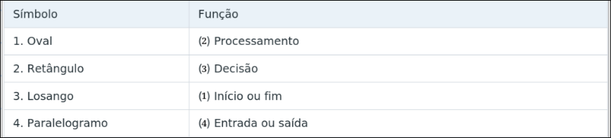
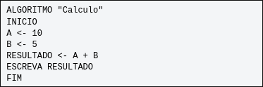
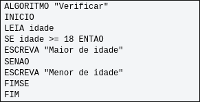
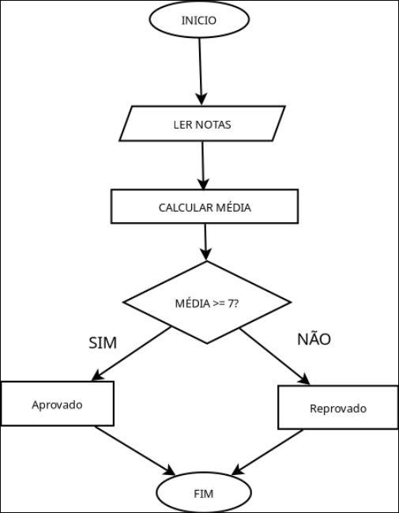
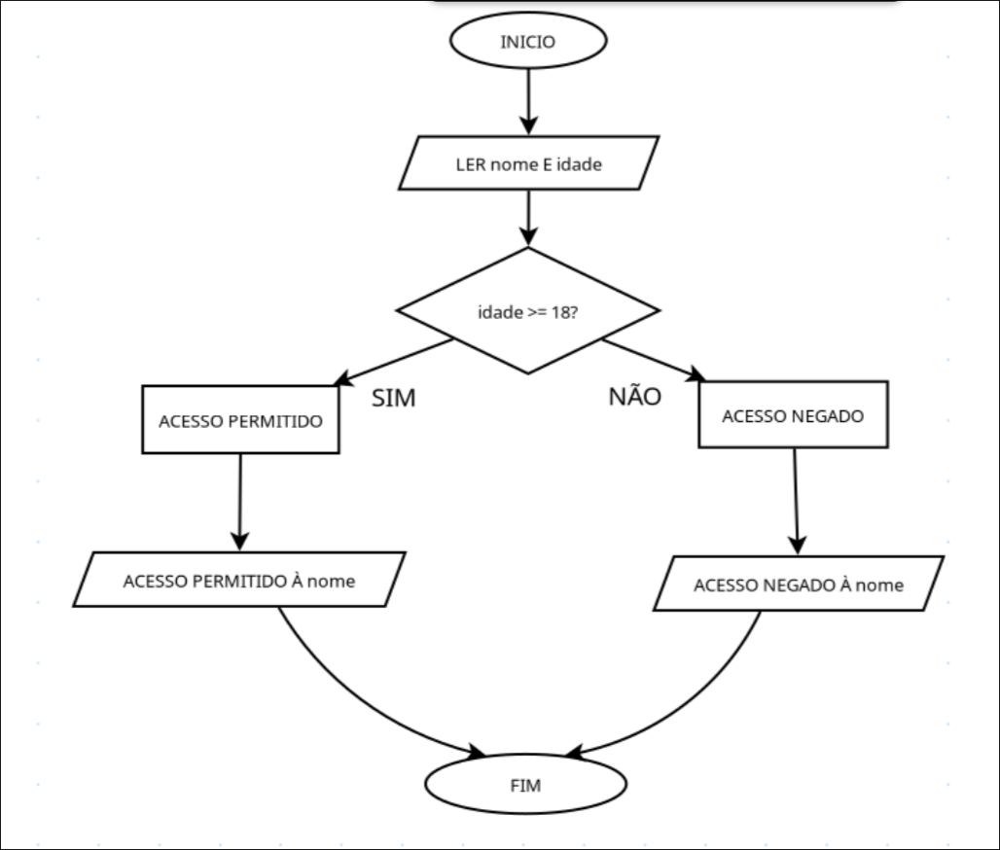

# Lógica de Programação: do Pseudocódigo ao Fluxograma
## Curso Técnico • Informática / Desenvolvimento de Sistemas

- Aluno(a): Ícaro Sancho
- Turma: TEC.312.003
- Professor(a): Íkaro Santana 
- Data: 05/11/2026

## 3. Atividade – Questões de aprendizagem

### Parte A – Conceitos fundamentais <br>    
Questão 1. Explique, com suas palavras, o que é um algoritmo e apresente um exemplo de sua utilização no cotidiano.

R:
```
Um algoritmo são instruções agrupadas e logicamente ordenadas em sequência 
para realizar uma ação ou alcançar um objetivo.
Um exemplo é uma receita de bolo:

1. Reunir os ingredientes e pré-aquecer o forno.

2. Misturar os ingredientes secos em uma tigela.

3. Bater a manteiga com o açúcar e, em seguida, adicionar os ovos.

4. Combinar as misturas líquidas e secas para formar a massa.

5. Despejar a massa em uma forma e assar até ficar pronto.

6. Deixar o bolo esfriar antes de cobrir e servir.
```
<br><br>
Questão 2. Qual é a principal diferença entre pseudocódigo e fluxograma?

R: 
``` 
Pseudocódigo é a representação textual utilizando linguagem natural para 
descrever a composição das etapas de um algoritmo, enquanto o fluxograma 
é uma representação visual do fluxo geral de um algoritmo.
``` 
<br><br>
Questão 3. Observe as etapas: receber dois números; somar os números; mostrar o resultado.<br>
Identifique:

• a) A entrada de dados.

• b) O processamento.

• c) A saída de dados.


R: 
```
Entrada de dados <- receber dois números
Processamento <- somar os números
Saída de dados <- mostrar o resultado
``` 
<br><br>
Questão 4. Relacione os símbolos dos fluxogramas com suas respectivas funções. <br>
    
 

<br><br>
    
### Parte B – Interpretação de pseudocódigo

Questão 5. Analise o algoritmo abaixo e responda aos itens.



• a) Qual é o valor da variável A?

• b) Qual é o valor da variável B? 

• c) Qual será o resultado apresentado na tela?

• d) Qual operador foi utilizado?

R:
```
• a) 10.
• b) 5.
• c) 15.
• d) Soma.
```
<br><br>
Questão 6. Observe o pseudocódigo. Se o aluno informar as notas 8 e 6, qual será a média
apresentada?

R:
```
MEDIA = (8 + 6) / 2 =
14 / 2 =
7

A média representada será 7.
```
<br><br>
Questão 7. Analise o algoritmo e responda aos itens.



• a) O que acontece quando a idade informada é 20?

• b) O que acontece quando a idade informada é 15?

• c) Qual estrutura lógica foi utilizada?

R:
```
a) O algoritmo irá devolver "Maior de idade" como resultado.
b) O algoritmo irá devolver "Menor de idade" como resultado.
c) Lógica Condicional.
```
<br><br>

### Parte C – Construção de algoritmos

Questão 8. Uma loja deseja calcular o valor total de uma compra. Elabore um pseudocódigo que
solicite o preço de um produto, solicite a quantidade comprada, calcule o valor total e apresente o
resultado.

R:
```
ALGORITMO "TotalDoPedido"
INICIO 
LEIA preço_produto
LEIA qntd_produto
TOTAL <- preço_produto * qntd_produto
ESCREVA TOTAL
FIM
```
<br><br>
Questão 9. Um sistema precisa verificar se um número é positivo ou negativo. Elabore um
pseudocódigo que receba um número e apresente:

• "Número positivo", se for maior que zero.

• "Número negativo", se for menor que zero.

• "Número igual a zero", se for igual a zero.

R:
```
ALGORITMO "VerificarNúmero"
INICIO
LEIA numero
SE numero = 0
ESCREVA "Número igual a zero"
SENAO numero > 0 
ESCREVA "Número positivo"
SENAO numero < 0
ESCREVA "Número negativo
FIMSE
FIM
```
<br><br>
Questão 10. Uma escola deseja criar um sistema para verificar a aprovação de seus alunos. O
sistema deverá solicitar duas notas, calcular a média, verificar se a média é maior ou igual a 7 e
apresentar “Aprovado” ou “Reprovado”. 

Elabore o pseudocódigo e represente o algoritmo por meio
de um fluxograma.

R:
```
ALGORITMO "Media"
INICIO
LEIA nota1
LEIA nota2
MEDIA <- (nota1 + nota2) / 2
SE MEDIA >= 7
ESCREVA "Aprovado"
SENAO
ESCREVA "Reprovado"
FIMSE
FIM
```
### Fluxograma



<br><br>

### 4. Atividade prática – Desafio de programação
### Desafio em dupla: Sistema de controle de acesso

Uma empresa deseja desenvolver um sistema simples para controlar a entrada de visitantes. O
sistema deverá:

• Solicitar o nome do visitante.

• Solicitar sua idade.

• Verificar se o visitante possui 18 anos ou mais.

• Caso tenha 18 anos ou mais, apresentar "Acesso permitido".

• Caso contrário, apresentar "Acesso não permitido".

• Exibir o nome do visitante junto à mensagem final.

R:
```
ALGORITMO "ControleDeAcesso"
INICIO
LEIA nome
LEIA idade
SE idade >= 18
ESCREVA "Acesso permitido à ", nome
SENAO
ESCREVA "Acesso não permitido à ", nome
FIMSE
FIM
```
### Fluxograma


